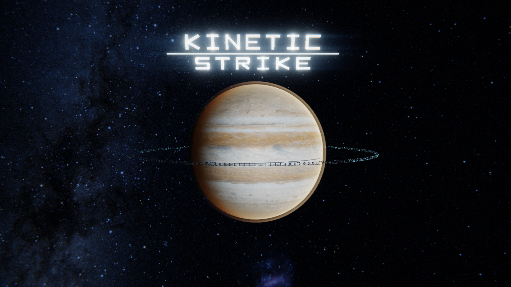
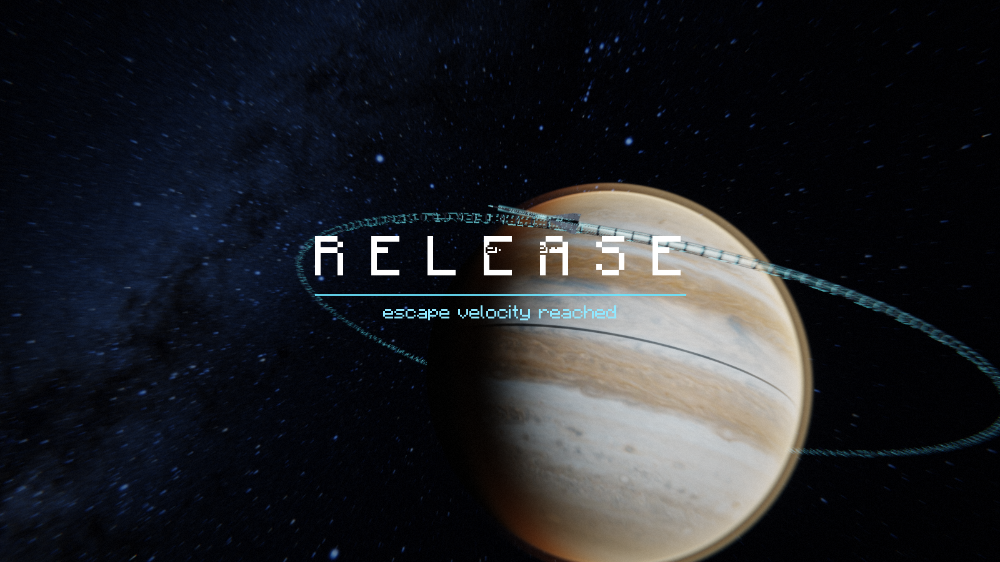
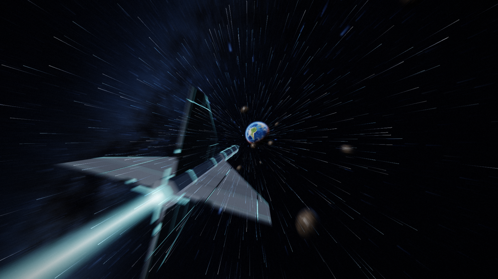
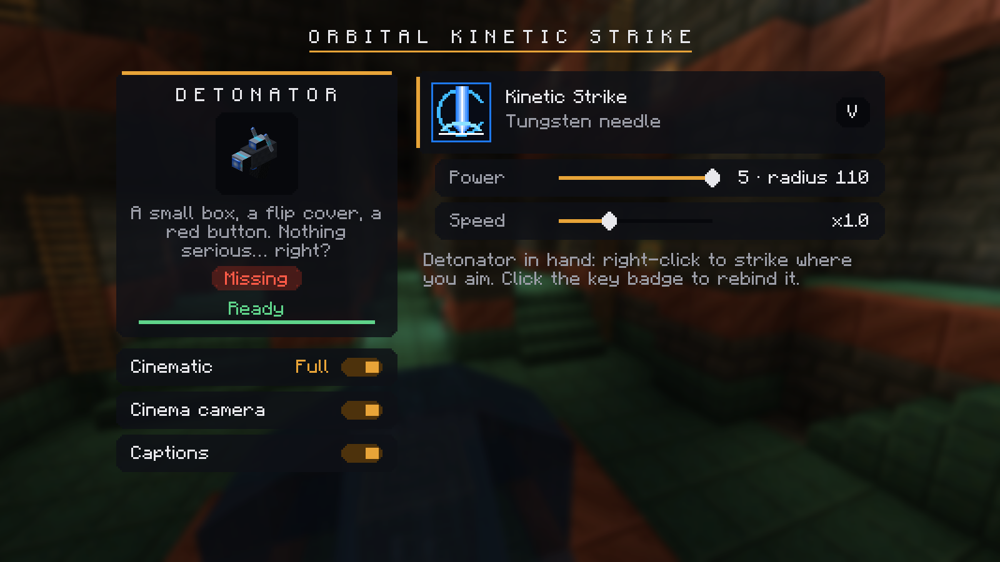

# Orbital Kinetic Strike (`orbital_strike`)


-blue?style=flat-square)


An open-source **Minecraft 1.21.1** (**Fabric**) mod by **DrakkarF7**, **100% AI-generated** and released into the Public Domain (**CC0-1.0**).

With the **Orbital Detonator**, aim at a target on the ground to trigger a full **3D HDR space cinematic**: orbital targeting laser, liftoff along the beam, cloud breakout, hyperspace jump to Jupiter, loading inside a 72-module segmented accelerator ring, tangential ejection along the ring arc, plasma-sheathed atmospheric reentry, vertical sky dive, stylized silent detonation, towering tungsten spire, molten fissured crater, and distance-delayed sonic boom.

> **Want to fork, learn, or contribute?** Read [`CONTRIBUTING.md`](CONTRIBUTING.md), [`docs/architecture.md`](docs/architecture.md), and [`docs/specification.md`](docs/specification.md).

---

## Visual Preview

| Accelerator Ring & 3D Title | Tangential Release |
|---|---|
|  |  |

| Debris Field & Reentry Chase | Orbital Detonator Menu |
|---|---|
|  |  |

---

## Requirements & Installation

1. Install **Minecraft 1.21.1**.
2. Install **Fabric Loader** (`>= 0.16.0`, tested with `0.16.14`) and **Fabric API** (`0.116.7+1.21.1` or compatible `1.21.1`).
3. Download `orbital-strike-2.0.0-alpha.11.jar` (from Releases or the repository root) and drop it into `.minecraft/mods/`.
4. *(Optional, recommended)* **Sodium** (`0.6.13+mc1.21.1`) and **Iris** (`1.8.8+mc1.21.1`) are supported out of the box.

---

## In-Game Usage

| Action | Default Key / Input |
|---|---|
| Open Orbital Detonator menu | `R` (rebindable under *Options > Controls*) |
| Aim and fire a strike | Hold **Orbital Detonator**, aim, **Right-click** |
| Quick hotkey (Detonator anywhere in inventory) | Hold `V` to aim, release to fire (configurable in menu) |
| Skip space cinematic | `Esc` |

- **Crafting Recipe**: 6 Netherite Blocks on the left and right columns; center column (top to bottom): Spyglass, Redstone Block, Eye of Ender.
- **Detonator Menu**:
  - **Power (`1`–`5`)**: adjusts crater bowl radius (`22` to `110` blocks), max shockwave reach (up to `400 * (power / 4)` blocks), and central spire height (up to `135` blocks).
  - **Cinematic Speed**: `x0.5` to `x2.0`.
  - **Cinematic Mode**: **Full** (`FULL`), **Short** (`SHORT` — reentry only), or **Off** (`OFF`).
  - Toggles for director captions and world-space cinema camera.

---

## Operator Commands (Permission Level 2+)

```text
/orbitalstrike strike <x y z> [power]   Trigger an immediate strike with no cinematic
/orbitalstrike undo [id]                Restore exact pre-strike blocks and block entities
/orbitalstrike log                      Display recent strikes
/orbitalstrike resetcooldown [player]   Reset personal cooldown
/orbitalstrike reload                   Reload config/orbital_strike.json
```

`/orbitalstrike undo` restores modified blocks and block entities from compressed NBT snapshots in `<world>/data/orbital_strike/undo/`. *(Note: secondary post-impact propagations outside the crater, such as spreading fire or flowing water, are not tracked.)*

---

## Configuration

### Server — `config/orbital_strike.json`

| Key | Default | Description |
|---|---|---|
| `maxRange` | `256` | Maximum ground targeting range |
| `defaultPower` / `maxPower` | `3` / `5` | Default power and server ceiling |
| `cooldownSeconds` | `300` | Personal cooldown (seconds) |
| `globalCooldownSeconds` | `0` | Global server cooldown (`0` = disabled) |
| `terrainDestruction` | `true` | If `false`, deals damage & FX without destroying blocks |
| `affectPlayers` | `true` | Whether strikes harm other players |
| `impactDamage` / `shockwaveDamage` | `1000` / `30` | Impact center and shockwave front damage |
| `craterMsPerTick` | `6` | Server tick budget (ms) for lag-free crater excavation |
| `moltenCoolingMinutes` | `10` | Average cooling duration for molten rock |
| `thermalConduitDecayMinutes` | `10` | Decay duration for thermal conduits |
| `maxConcurrentStrikes` | `3` | Maximum simultaneous active strikes |
| `maxEjecta` | `60` | Maximum debris ejecta launched on impact |
| `treeFelling` / `maxFelledTrees` | `true` / `80` | Perimeter tree felling / charring |
| `scorch` | `true` | Scorched zone around the crater |
| `respectSpawnProtection` | `true` | Blocks strikes targeting spawn protection |
| `undoMaxSnapshots` | `3` | Number of persisted `undo` snapshots kept |
| `strikeLog` | `true` | Console + `logs/orbital_strike-strikes.log` logging |
| `showCinematicToNearbyPlayers` | `false` | Broadcasts space cinematic to nearby players |
| `opOnly` | `false` | Restricts triggering to operators only |

### Client — `config/orbital_strike-client.json`

Stores client preferences (`power`, `speed`, `cinematicMode`, `skillKey`, `bloom`, `supersampling`, `lensEffects`, `godRays`, `motionBlur`, `directorCaptions`, `worldCamera`, `forceCamera`, `photosensitive`, `shakeIntensity`).

---

## Building & Testing (Developers)

**Prerequisites:** JDK `21`

```powershell
# Windows (PowerShell)
.\gradlew.bat test --rerun-tasks build   # Build mod JAR and run all 21 JUnit tests
.\gradlew.bat runClient                  # Launch Minecraft dev client (Sodium + Iris included)
.\gradlew.bat runSelftest                # Render 20 reference PNG captures to run/selftest/
.\gradlew.bat runWorldtest               # Live server <-> client chunk sync verification test
```

```bash
# Linux / macOS
./gradlew test --rerun-tasks build
./gradlew runClient
./gradlew runSelftest
./gradlew runWorldtest
```

### Procedural Asset Scripts (`tools/`)

- `python tools/generate_textures.py`: procedural block, item, particle, and cloud textures
- `python tools/import_nasa_textures.py`: converts public-domain NASA sources in `art/textures/nasa/` into `textures/space/`
- `python tools/generate_models.py`: generates `ring_module.obj` and `needle.obj`
- `python tools/generate_sounds.py`: synthesizes all 15 `.ogg` tracks (requires `numpy`, `soundfile`)

---

## Open Source, AI & Credits

- **Author / Direction:** **DrakkarF7**
- **License:** **CC0-1.0** ([`LICENSE`](LICENSE)) — **100% AI-generated** open-source project. Anyone is free to copy, modify, compile, redistribute, and reuse all files without restriction.
- **Assets & References:** All code, shaders, 3D models, audio, and procedural textures were created for this project. Space maps use public-domain NASA/JPL/GSFC imagery listed in [`CREDITS.txt`](CREDITS.txt).
